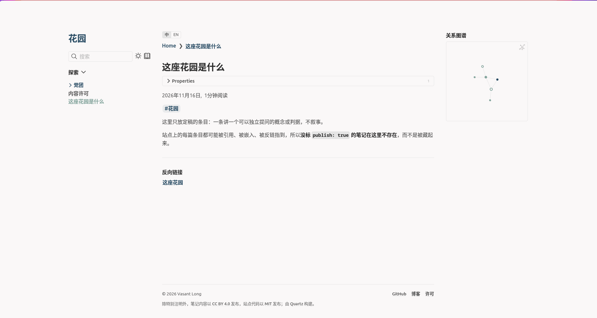

昨天，[notes.vasantlong.de5.net](https://notes.vasantlong.de5.net) 上线了。博客菜单里多了一个「Notes」。为了方便理解，在此说明：站名 notes，菜单与页面标题都写 **Notes**，定位是文档库；站内出现的「花园」只是 digital garden 这个形态的比喻，不作站名。

相较于当前的blog主页，我更希望它承担document的职责，obsidian式的文档结构很契合。在上周复习结业考试的时候，也是刚上手obsidian（之前一直被网上广为流传的“学习成本高”“花里胡哨”吓到，一直没尝试），双链真的是一个非常实用的功能，用我以前纸质笔记复习类比的话，就是我的若干页面跳转标签哈哈哈，最后短时间突击的效果还不错。

这篇主要聊聊，在 D老师的谆谆教导下，notes上线的过程。

这里D老师指代我的pi agent，峰谷时的4.1 flash还是性价比非常能打，加上最近领了阿里云的学生券，除了买云服务也可以调大模型，这下我能比较肆无忌惮地想起来就用一下。

## 一、博客框架是否兼容笔记

我最初只是想讨论，目前有没有框架可以形成obsidian官方publish的效果，毕竟每个月官方$10还是很贵了，有免费平替的话更有动力和自由度。这个想法源自我折腾webNAV来实现iPad和minihub同步，后来想想，网站也算是另一种同步。不过需要考虑隐私安全。

博客当前的Hugo对obsidian的双链就很不兼容，D老师分析出三个坏消息：

- `[[..]]` 不被 goldmark 解析；
- render hook 根本不会被调用；
- `%%私有注释%%` 会原样出现在线上。

排版层（callout、任务列表、折叠、脚注、块级公式）正常，唯独是双链。

虽然有一些社区方案，但是维护成本不低，复刻关系图谱更是难上加难了。同时笔记也存在更新的情况，这与blog的时效性也有冲突。所以我开始考虑Quartz（检索到了这个[示例](https://obsidian-quartz-notes-ten.vercel.app/)）。

## 二、 一次次否定后形成的ADR

我的假设是“全部换成Quartz”，因为当时选择Hugo仅仅是一次上线个人网站的尝试，轻量化优先。D老师给出了“Blowfish主题和站点security check重写”的否定意见。确实得不偿失。

于是有了 ADR-0001：花园独立成站、独立仓、Quartz 5.1.0、GitHub Actions → Pages；博客原地不动。

记录了两种被否定路径的影响：

- **留在 Hugo，加语法垫片**：一处 CI、一份安全基线；代价是那两三百行永久自维护，且永远拿不到反链与嵌入。
- **全盘换 Quartz**：语法一次到位；代价是丢主题定制、12 项检查大半失效、URL 形态变化让存量链接全断。

因此需要把notes独立出来还是必要的。

## 三、如何管理公开与私有笔记的状态

> ADR-0002 ：花园只从一个**专用 vault** 出，知识库永不进入构建输入。安全靠“内容源里没有”，不靠“配置写对了”。

闸门还是做了两道，但这属于第二层保险：

- 构建期的 `explicit-publish`：没标 `publish: true` 的笔记在站点上**不存在**，不是隐藏；
- 推送前的字段校验：缺 `title`、`description`、`date`，或者把 `publish` 写成字符串 `"true"`，直接失败，不进产物。

Quartz 对缺字段是静默兜底，所以需要补充一些校验：标题回落成文件名，没描述就不生成 meta。

在这里，`unlisted` 不代表隐私保护，只是从搜索、索引、图谱、RSS 里消失，直链照样能开，爬虫也能抓。

## 四、notes上线后第一次上传库

经过一番测试和子域名配置后，notes的上线观感我很满意，正好可以把最近的一组笔记上传试试看，也就是下文所说的“党团”。其中遇到了一些坑：

**部署完之后，党团为什么不在目录里？** `folderDefaultState: open`使得界面照旧折叠。D老师指出：explorer 组件只在容器上写一个 `data-collapsed` 属性，客户端脚本从不读它——这是个死选项，**配了等于没配**。补法是加一段 afterDOM 脚本，同时尊重读者已经折叠过的目录。

**`buildQuartz is not a function`。** 测试必须串行。每个 fixture 都真跑一次构建，构建期把 `.quartz-cache/transpiled-build.mjs` 写死在同一路径，并行时两个进程互相覆盖那份临时包。偶发、难复现、看起来像上游的锅——不是。

**两种斜杠。** 花园的 URL 不带结尾斜杠，博客带。比如`/这座花园是什么/` 直接 404，去掉斜杠就可访问。

## 五、上线界面雏形

目前是一个原始状态，样式和互动（评论）还没有调，主打一个先完成再完美吧。用GitHub Pages主打一个零成本实践和自动化。

不过之前我碰到过，workflow超过60天不活动，GitHub 就自动停用的情况（至于是怎么经历到的先不展开）。变相不让我鸽了属于是（小红书一个月没更长文了emm）。 希望通过vlog和notes能增长我的写作表达，如果在搜索引擎被人引用，这种输出是我更荣幸看到的。后续我会尝试把我的服务器kb去除敏感信息上传一些，回归一下geek的初衷（bushi）。
